## Hello, I'm jpflegha

Software engineering student at [42 Heilbronn](https://www.42heilbronn.de/en/).

I focus on systems programming, networking and infrastructure: writing low-level code in C and C++, building servers, and running services in containers.

  
  
  
  
  
  

---

## 42 Core Curriculum

### Completed

<a href="https://github.com/jpfleghaar/libft">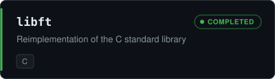</a>
<a href="https://github.com/jpfleghaar/printf">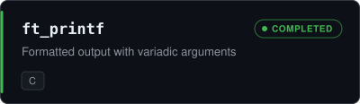</a>
<a href="https://github.com/jpfleghaar/Get-Next-Line">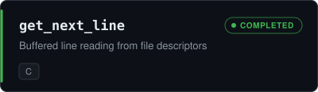</a>
<a href="https://github.com/jpfleghaar/push_swap">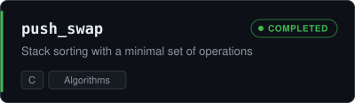</a>
<a href="https://github.com/jpfleghaar/minitalk">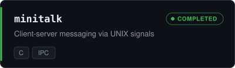</a>
<a href="https://github.com/jpfleghaar/fract-ol">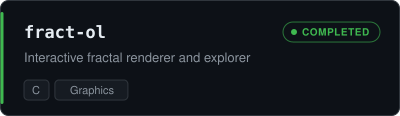</a>
<a href="https://github.com/jpfleghaar/philo">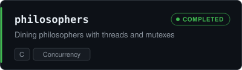</a>
<a href="https://github.com/jpfleghaar/minishell">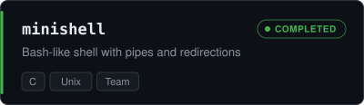</a>
<a href="https://github.com/jpfleghaar?tab=repositories&q=CPP">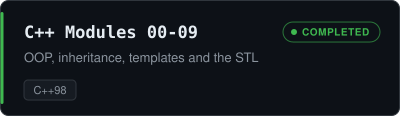</a>
<a href="https://github.com/jpfleghaar/webserv">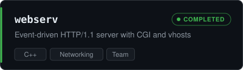</a>
<a href="https://github.com/jpfleghaar/Inception">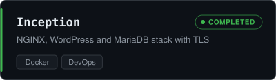</a>
<a href="https://github.com/jpfleghaar/miniRT">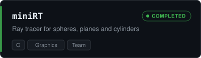</a>

### In Progress

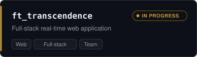

